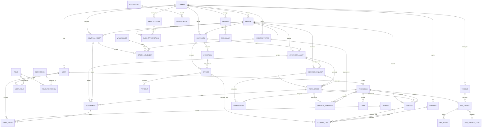

# ServicePro Architecture and Delivery Plan

## 1. Scope and governing requirements
This architecture is based on the ServicePro master specification and is intended to be a faithful, requirement-led design baseline. It does not simplify, remove, or reinterpret any explicit business requirement. Where the specification is silent or requires a policy choice, the design identifies the issue as an open decision rather than inventing a company rule.

The core governing constraints are:
- single application, one login, shared database
- modular monolith for the initial release
- organisation-scoped master data and transactional records
- strict financial integrity and balanced accounting postings
- independent technician mobile GPS and dedicated vehicle GPS tracking streams
- no technician reject-appointment path
- manager approval required for technician postponement
- no compulsory fixed next service date
- separate customer-owned assets and company-owned assets
- material custody transfer only after receipt confirmation
- invoice creation only from approved, completed, and billable work, with accounting posting driven by the accounting engine

## 2. Revised architecture summary

### 2.1 Core design principles
- One secure application, one shared database, one login, one organisation domain.
- Modular monolith architecture with clear module boundaries and package separation.
- Shared organisation-scoped masters: company, branches, users, roles, permissions, customers, vendors, items, bank accounts, and GL accounts.
- Strict accounting integrity: every financial transaction posts balanced journal entries through the accounting engine; no direct, ad hoc financial posting from operations modules.
- Independent operational tracking streams: technician mobile GPS and vehicle GPS are different identities and must never be merged into a single anonymous device stream.
- Immutable raw sensor events and auditable processing steps for all GPS streams.
- Customer-owned assets and company-owned assets are separate registries with distinct lifecycle rules and custody logic.
- External integrations are defined as service interfaces and explicitly marked as configuration-dependent or provider-dependent.

### 2.2 High-level system view
Frontend:
- React + Vite + Tailwind + shadcn/ui
- dashboard, manager modules, branch operations, finance, reporting, role-specific views
- global search, notifications, workflow approvals, forms, tables, map views, export actions

Backend:
- Java 21 + Spring Boot 3 + Spring Security + JWT + Spring Data JPA + Hibernate
- modular service layer for authentication, core operations, field service, accounting, GST, banking, reporting, and integrations
- validation, auditing, security, and exception handling in shared infrastructure

Database:
- MySQL 8 InnoDB
- constrained foreign keys and explicit join tables for many-to-many relationships
- organisation_id on organisation-scoped tables
- BigDecimal for all financial values and tax calculations
- audit tables and immutable event logs

## 3. Corrected business-rule architecture

### 3.1 Asset separation
Customer-owned assets and company-owned assets must not share the same table or lifecycle logic.

Required model:
- customer_asset_registry: assets that belong to the customer and serve service execution, warranties, AMC tracking, and history
- company_asset_registry: tools, equipment, spare parts, machinery, and inventory under the company’s custodial ownership
- customer_asset_service_history and company_asset_custody_history are separate operational histories

This preserves the requirement that customer assets and company assets remain separate while still allowing cross-reference relationships where needed for service planning.

### 3.2 User-role and role-permission relationships
The previous relationship model was underspecified. It must be resolved as many-to-many relationships:
- user_roles: user_id + role_id
- role_permissions: role_id + permission_id
A user may belong to multiple roles, and a role may carry multiple permissions.

This is required for Super Admin, Admin, Manager, Accountant, Technician, Auditor, and other authorised employees without forcing one role per user.

### 3.3 Technician appointment and postponement constraints
The platform must enforce:
- technicians do not have a reject appointment option
- technician postponement is not a direct rejection; it must be a request with mandatory reason and proposed date/time
- managers approve or decline the postponement request
- rescheduling by manager remains authorised as an operational control
- no specialisation-based job restrictions are implemented

These are mandatory business constraints and must be enforced in both API validation and UI flow.

### 3.4 GPS identity model
GPS tracking must remain clearly separated across two independent data pipelines:
1. technician mobile GPS from technician devices
2. dedicated vehicle GPS hardware from mounted vehicle trackers

The system must not collapse them into one generic tracking stream.

Rules:
- technician mobile GPS device records are bound to a technician and optional user identity
- vehicle GPS tracker records are bound to a vehicle and route/vehicle operational context
- live data, route history, stale state, and offline conditions are reported separately per source
- manager map displays may overlay both sources, but their identity remains distinct

### 3.5 Raw GPS event storage and immutability
All raw GPS observations must be stored as immutable audit-grade records.

Required fields:
- gps_event_id
- source_type: TECHNICIAN_MOBILE or VEHICLE_TRACKER
- source_device_id
- source_user_id or vehicle_id depending on source type
- latitude, longitude
- accuracy_meters
- speed_kmh
- bearing_degrees
- event_timestamp_utc
- received_timestamp_utc
- stale_flag
- stale_reason
- last_updated_at
- location_quality

This supports accurate stale/tracking status evaluation without rewriting raw sensor history.

### 3.6 Accounting dependency and invoice creation contract
Invoice creation may occur in Phase 10, but the financial posting must not happen outside the accounting engine.

The required dependency is:
- operations modules may create an invoice draft or invoice record for approved/completed/billable work
- the accounting module validates business rules and creates the accounting entry set
- invoice posting is a downstream service call to the accounting engine
- posting cannot be bypassed by any operational module

Required contract before invoice implementation:
- InvoicePostingRequest with invoice_id, organisation_id, customer_id, branch_id, posting_date, currency, tax_summary, doc_reference
- AccountingPostingResult with journal_id, journal_number, status, line_count, and posting summary
- validation service checks for completeness, approval, billable status, and matching financial legs
- financial record creation is performed only by the accounting service layer

This preserves the requirement that all posted financial transactions generate balanced debit and credit entries and that posted journals are never silently modified.

### 3.7 Material custody workflow
Material custody changes only after receiver confirmation.

Workflow:
1. Technician A requests material.
2. Technician B receives the request.
3. Technician B accepts or declines.
4. Handover is recorded.
5. Technician A confirms receipt.
6. Custody changes on successful receipt confirmation only.
7. Any transfer status before receipt confirmation remains provisional.

This is a mandatory business rule and should be enforced at domain and workflow level, not approximated in the UI alone.

## 4. Corrected database design

### 4.1 Core entities and registry separation
Core entity set must include:
- company
- user
- role
- permission
- user_role join
- role_permission join
- customer
- branch
- customer_asset
- company_asset
- service_request
- work_order
- appointment
- technician
- vehicle
- gps_device
- gps_event
- trip
- travel_rate
- inventory_item
- warehouse
- stock_movement
- material_transfer
- quotation
- invoice
- payment
- expense
- vendor
- account
- journal
- journal_line
- tax_code
- bank_account
- bank_transaction
- fixed_asset
- attachment
- audit_event

### 4.2 Database principles
- organisation_id on all records that are organisationally scoped
- branch_id where branch context is relevant
- strong foreign keys for all relationship tables
- unique natural keys where required (for example bank codes, branch codes, GSTIN, asset IDs when appropriate)
- soft delete or status field for compliance workflow where required; never silently overwrite posted journals
- indexes on IDs, foreign keys, status, date ranges, and business-search fields
- transaction boundaries around all financial records and material custody state changes
- BigDecimal for currencies and all financial line amounts

### 4.3 Relationship design summary
- user to role: many-to-many, join table user_role
- role to permission: many-to-many, join table role_permission
- company to branch: one-to-many
- branch to customer: one-to-many
- branch to customer_asset and company_asset: one-to-many or branch-scoped registry mapping
- customer to customer_asset: one-to-many
- customer_asset to service_request and work_order: one-to-many
- company_asset to stock_movement and custody records: one-to-many
- work_order to appointment: one-to-many
- work_order to attachment: one-to-many
- technician to service work and trip records: one-to-many
- vehicle to gps_device: one-to-many
- gps_device to gps_event: one-to-many
- technician to gps_device: one-to-many, but separate from vehicle mapping
- trip to travel_rate: many-to-one using a valid effective-date rate lookup
- inventory_item to stock_movement: one-to-many
- material_transfer to transfer step history: one-to-many
- quotation to invoice: one-to-many for conversions, but invoice creation is separated from quote conversion by business rules
- invoice to payment: one-to-many
- journal to journal_line: one-to-many
- account to journal_line: one-to-many
- bank_account to bank_transaction: one-to-many
- fixed_asset to depreciation schedule and disposal records: one-to-many
- audit_event to user, entity type, entity id: many-to-one with a polymorphic entity reference pattern or explicit event record table where required

## 5. Corrected ER diagram

## 6. Database relationship explanations

### 6.1 User-role and role-permission relationships
- Many users may share one role.
- Many roles may be granted to one user.
- Many permissions may belong to one role.
- Many roles may reference one permission.
- This structure supports Super Admin, Admin, Manager, Accountant, Technician, Auditor, and future specialised roles without brittle hardcoded permission checks.

### 6.2 Customer-owned vs company-owned asset separation
- customer_asset is bound to a customer and branch and tracks asset-specific service history, warranty, AMC, and field-service requirement.
- company_asset is bound to the company and maybe a warehouse or assigned custodian; it tracks ownership, stock, movement, inventory custody, and internal operational use.
- Cross-references are explicit and controlled, not a single shared asset table with overloaded meaning.

### 6.3 GPS and event tracking separation
- technician mobile GPS is represented by gps_device records with source_type = TECHNICIAN_MOBILE and a technician linkage
- vehicle GPS is represented by gps_device records with source_type = VEHICLE_TRACKER and a vehicle linkage
- gps_event stores immutable raw points from either source with a stable source identity
- aggregated route data is derived from the raw event stream and not used to replace source identity

### 6.4 Immutable raw GPS event storage
Raw events are never updated in place. Instead:
- append-only event storage
- source identity preserved by source_type + source_device_id + technician_id or vehicle_id
- timestamps captured in UTC and local time if required
- stale checks computed from last event age, network status, and source-liveness rules
- a derived gps_summary or trip data is computed from raw events for use in dashboards and trip mapping

### 6.5 Invoicing and accounting separation
This is a critical architectural rule:
- business operations can determine an invoice should be generated based on an approved completed work order
- the financial posting is created by the accounting engine
- the accounting engine validates invoice completeness, tax summary, GL mapping, and posting date before generating balanced entries
- each journal_line is validated, and journal posting cannot be bypassed by UI or service module logic

### 6.6 Material transfer and custody enforcement
Material transfer is not final at handover. The receiving technician and the requesting technician must confirm receipt before custody is changed. This removes the risk of premature custody transfers and keeps a clear transfer history for audit and dispute resolution.

## 7. Module dependency map

### 7.1 Core dependency order
1. Authentication and access control
2. Company, branch, location, and master data
3. User, role, and permission management
4. Customer management and customer asset registry
5. Company asset and inventory management
6. Service requests and work order lifecycle
7. Technician management and appointment rules
8. GPS device and trip management
9. Monthly service and AMC handling
10. Inventory transfer and custody workflows
11. Quotation and billing preparation
12. Expense and payables preparation
13. Accounting engine and journal posting
14. GST and tax processing
15. Banking, reconciliation, and statement matching
16. Financial reporting and export
17. Integration services and notifications
18. Testing, deployment, and operational hardening

### 7.2 Dependency rule for business flows
- Service and field-work modules depend on master data, technician rules, and GPS rules.
- Billing modules depend on service completion approval and work status.
- Accounting depends on invoice, expenses, bank transactions, tax codes, and master accounts.
- Reporting depends on all validated upstream data and should never be treated as a source of truth.
- Integration services depend on core domain state but must not bypass validation and audit rules.

## 8. Phase-by-phase acceptance criteria

### Phase 1 — Project setup and architecture
Acceptance criteria:
- frontend and backend folder structures are defined
- build tools and dependency baselines are established
- package and module layout align to modular monolith design
- security, config, and environment strategy are documented
- no functional feature development begins before this phase is approved

### Phase 2 — Authentication and role management
Acceptance criteria:
- login, logout, JWT issuance, refresh handling, and password hashing are implemented
- user-role and role-permission relationships are validated
- roles and permissions enforce API-level access control
- audit event logging for authentication and privilege changes is in place

### Phase 3 — Company, bank, and branch management
Acceptance criteria:
- company, branch, bank, and customer masters are created and scoped by organisation
- branch codes and contact information are stored and searchable
- entity validation and indexes are defined for lookup performance

### Phase 4 — Customer asset management
Acceptance criteria:
- customer-owned assets are stored in a separate registry from company-owned assets
- warranty, installation, AMC, and servicing metadata are supported
- service history and attachment links are available

### Phase 5 — Service requests and work orders
Acceptance criteria:
- service requests can be created, assigned, and tracked
- work order lifecycle states are enforced
- manager rescheduling works
- technicians cannot reject appointment requests
- postponement requires a reason and manager approval

### Phase 6 — Technician management
Acceptance criteria:
- technician profiles, attendance, work history, and assigned job visibility are supported
- no skill-specialisation restriction is imposed
- technician dashboards reflect assigned jobs and status without introducing role-based job assignment limits

### Phase 7 — GPS and trip management
Acceptance criteria:
- technician mobile GPS and vehicle GPS are clearly separated in design and data model
- raw GPS events are immutable and retained with source identity and timestamps
- stale/offline detection is computed from live event data
- trip summaries are derived from correct source-specific event streams

### Phase 8 — Monthly service and AMC
Acceptance criteria:
- monthly asset service cycles are supported without requiring a mandatory fixed next service date
- service completion is allowed within the relevant month window
- AMC attachments support non-GPS camera uploads as required

### Phase 9 — Inventory and material transfers
Acceptance criteria:
- inventory items, warehouses, and stock movements are tracked
- transfer request, accept/decline, handover, and receipt confirmation workflow is enforced
- custody changes only after receiver confirmation

### Phase 10 — Quotations and invoicing
Acceptance criteria:
- quotation creation, GST, discounts, revisions, and approvals are supported
- invoice generation only occurs for approved, completed, billable work
- all invoice creation requests are routed to the accounting validation contract before financial posting

### Phase 11 — Expense management
Acceptance criteria:
- service expenses and office expenses are separate categories and approval flows
- only authorised accountants can mark expenses as paid
- receipt attachments and transaction references are stored

### Phase 12 — Accounting engine
Acceptance criteria:
- chart of accounts, general ledger, journals, and journal lines are implemented
- every posted financial transaction generates balanced entries
- controlled reversals and adjustments are supported as the only allowed modification strategy for posted journals
- account, branch, tax, and posting validation are enforced

### Phase 13 — GST and taxation
Acceptance criteria:
- GST codes, HSN/SAC, tax logic, and reconciliation support are in place
- internal features are separated from external/provider-dependent GST compliance services
- supply and tax treatment logic is clearly modelled and auditable

### Phase 14 — Banking and reconciliation
Acceptance criteria:
- multiple bank accounts, statements, transfers, bank charges, and UTR records are supported
- reconciliation and duplicate detection are present
- bank transactions remain tied to source financial records and approval states

### Phase 15 — Financial reports
Acceptance criteria:
- P&L, balance sheet, trial balance, aging, GST, stock movement, bank reconciliation, and asset reports are generated from validated source data
- date, branch, customer, vendor, and account filters are supported
- export options are available where required

### Phase 16 — Integrations and notifications
Acceptance criteria:
- map provider, object-storage, notification, and external document interfaces are implemented as configurable adapters
- system requirements explicitly distinguish configured live integrations from pending provider setup

### Phase 17 — Testing and deployment
Acceptance criteria:
- unit and integration tests cover critical workflows and security conditions
- financial validation tests confirm balanced postings and controlled reversals
- deployment and environment strategy are production-ready

## 9. External integrations and unresolved business decisions

### 9.1 Integrations requiring explicit provider setup
- Google Maps or Mapbox for location and route display
- object storage for photos and document uploads
- email and SMS notification provider
- GST filing/e-invoice and e-way bill provider interfaces where required by local law
- bank feed or statement import provider where available

### 9.2 Open decisions requiring confirmation
1. Will the organisation support multiple currencies in the first production release, or will it stay INR-focused until the accounting structure is fully validated?
2. Which map provider will be selected for production and how route geometry will be stored and refreshed?
3. Will the organisation store fixed asset depreciation schedules in application logic only or also expose them to a dedicated asset accounting schedule engine?
4. Will bank statement imports be limited to CSV/XML or will feed-based bank integration be enabled immediately?
5. Will GST filing and e-invoice preparation remain internal with provider-based final filing, or will the organisation use a licensed compliance provider from day one?
6. Will all document retention, archival, and lifecycle management be handled by the application or by object storage policies?
7. Is payroll to be excluded entirely from scope, or is there a planned future integration not part of the current specification?

These decisions must be confirmed before production implementation. Until then, the architecture keeps them as explicit open decisions rather than hidden assumptions.

## 10. Security, audit, and compliance architecture
- JWT authentication and refresh token handling
- password hashing with strong adaptive algorithm
- role-based access control and record-level restrictions for sensitive financial data
- validation and sanitisation of every inbound request
- SQL injection prevention via JPA/Hibernate parameter binding
- CORS and secure HTTP headers
- audit trail for all critical operational changes, approvals, financial journals, and material transfer events
- secure file upload validation and access rules
- organisation-scoped data isolation
- separate approval responsibilities for field operations and financial payments

## 11. Missing or corrected elements from the earlier draft
The corrected architecture addresses the following earlier gaps and contradictions:
- customer-owned assets and company-owned assets are independent registries
- user-role and role-permission are many-to-many required structures
- GPS ownership is separated between technician mobile tracking and vehicle tracker tracking
- raw GPS events are immutable and identity-preserving
- stale and offline indicators are explicitly modelled
- invoice creation is decoupled from direct posting; accounting engine is the authority for financial postings
- material transfer custody changes only after receipt confirmation
- appointment restrictions and postponement rules are preserved as mandatory business logic
- open decisions are clearly separated from implemented requirements
- critical indexes, foreign keys, organisation scoping, and audit requirements are explicitly identified

## 12. Approval gate
This revised architecture aligns with the ServicePro specification and resolves the contradictions and under-specified domains in the earlier draft. It is ready for review and approval. After approval, the project will move to Phase 1 only, and each subsequent phase will be implemented and verified before moving forward.
